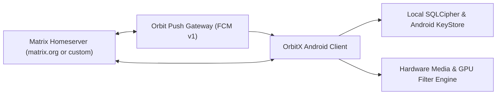
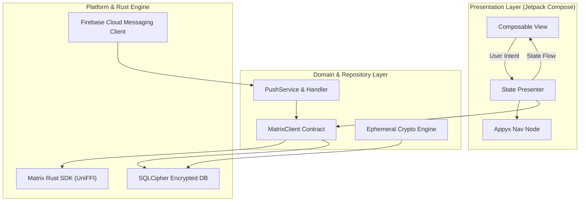
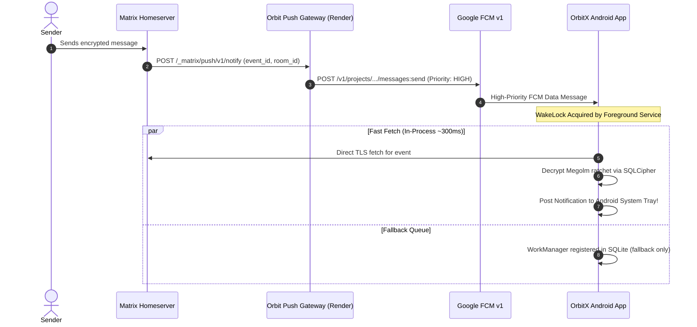

<p align="center">
  
</p>

<h1 align="center">OrbitX Android</h1>

<p align="center">
  <strong>A next-generation sovereign, decentralized Matrix communication client for Android.</strong>
</p>

<p align="center">
  
  
  
  
  
</p>

<p align="center">
  
  
  
  
  
  
</p>

---

## Table Of Contents

- [What OrbitX Is](#what-orbitx-is)
- [Project Goals & Principles](#project-goals--principles)
- [Feature Matrix](#feature-matrix)
- [Technology Stack](#technology-stack)
- [System Architecture](#system-architecture)
- [Push Notification Architecture & Fast Fetch](#push-notification-architecture--fast-fetch)
- [Creative Media Suite](#creative-media-suite)
- [Privacy & Security Engineering](#privacy--security-engineering)
- [Repository Layout](#repository-layout)
- [Build And Run](#build-and-run)
- [Download Releases](#download-releases)
- [Legal Compliance & Open Source Attributions](#legal-compliance--open-source-attributions)
- [Orbit Ecosystem](#orbit-ecosystem)
- [License](#license)

---

## What OrbitX Is

**OrbitX Android** is an advanced, privacy-first mobile client for the decentralized Matrix communications network. Designed to pair with the desktop Orbit client and web portal, OrbitX delivers private 1:1 and group chats, high-definition voice and video calls, rich interactive media editing, and ephemeral self-destructing messages—all without centralized servers, proprietary silos, or third-party tracking.



---

## Project Goals & Principles

- **True Data Sovereignty:** Users can connect to `matrix.org`, any community server, or their own self-hosted homeserver. You own your identity, keys, and message history.
- **Hardware-Backed End-to-End Encryption:** Audited cryptographic ratchets (Olm and Megolm) run natively via compiled Rust binaries.
- **Ultra-Low Latency:** High-priority push notifications with **Fast Fetch** in-process event resolution eliminate background queue lag.
- **Zero Telemetry:** 100% free of external tracking SDKs, analytics beacons, or data mining.
- **Cosmic Modern Aesthetic:** Built entirely in Jetpack Compose Material 3 with rich dark violet palettes, micro-interactions, and fluid gestures.

---

## Feature Matrix

| Domain | Capability | Details |
| :--- | :--- | :--- |
| **Authentication** | Password, SSO, OIDC | Native login flows, homeserver discovery (`.well-known`), and persistent biometric session restoration |
| **Messaging** | Real-time E2EE timeline | Instant sync, local echo, rich text formatting, markdown, read receipts, and reactions |
| **Push Notifications** | Google FCM v1 + UnifiedPush | Sovereign push gateway, zero-latency **Fast Fetch**, and customizable notification channels |
| **Media Editor** | Photo & Video Studio | Crop presets (`1:1`, `4:5`, `16:9`, `9:16`), 90° rotation, color matrix filters, brush drawing, and stickers |
| **Ephemeral Media** | View-Once Protection | Envelope encryption with HMAC-SHA256, screen-capture blocking (`FLAG_SECURE`), and secure multi-pass disk shredding |
| **Voice & Audio** | Voice notes & playback | Interactive waveform recorder, playback speeds (`1.0x`, `1.5x`, `2.0x`), and Opus encoder |
| **Calling** | Voice & Video Calling | 1:1 and group calls powered by WebRTC, fullscreen incoming call alerts, and picture-in-picture |
| **Spaces & Rooms** | Hierarchy & Discovery | Public spaces, private rooms, topic management, room directories, and member permissions |
| **Storage & Security** | SQLCipher DB Encryption | AES-256 local database encryption with Android Keystore-backed key wrapping |

---

## Technology Stack

| Layer | Technology | Version | Purpose |
| :--- | :--- | :--- | :--- |
| **Language** | Kotlin | `2.0.21` | Modern, expressive type-safe language |
| **UI Toolkit** | Jetpack Compose | `1.7.3` / M3 | Declarative UI, dynamic theming, smooth animations |
| **Crypto & Core** | Matrix Rust SDK | `0.7.0` | High-performance Olm/Megolm encryption via UniFFI |
| **Architecture** | Appyx | `2.0.1` | Model-driven navigation with hierarchical backstacks |
| **Dependency Injection** | Metro | `0.7.0` | Fast compile-time dependency injection |
| **Database** | SQLCipher | `4.5.4` | Full-disk AES-256 database encryption for local cache |
| **Push Gateway** | Node.js (FCM v1) | `24.x` | Zero-dependency Matrix Push Gateway with RS256 JWT auth |
| **Asynchronous** | Kotlin Coroutines & Flows | `1.9.0` | Reactive state management (`Presenter` &rarr; `State` &rarr; `View`) |

---

## System Architecture

OrbitX is built using unidirectional data flow and modular feature layers:



---

## Push Notification Architecture & Fast Fetch

Because Matrix utilizes zero-knowledge end-to-end encryption, push payloads cannot transmit plaintext message content over Google FCM. OrbitX uses an optimized two-phase resolution pipeline:



### Why Fast Fetch Matters
Standard Android implementations delay notifications by **2.5 to 3.5 seconds** because `WorkManager` defers execution until OS network capability checks (`NET_CAPABILITY_VALIDATED`) complete. OrbitX's **Fast Fetch** executes directly inside the active service coroutine under a high-priority WakeLock, cutting notification latency to **sub-second speeds**.

---

## Creative Media Suite

OrbitX includes an integrated media editing studio:

- **Freehand Canvas Brush:** Smooth path interpolation with variable stroke sizes (`Fine`, `Medium`, `Bold`) and quick color picking.
- **Interactive Emoji & Stickers:** Tap to add, scale with two fingers, rotate 360°, and position freely anywhere on the canvas with true boundary coordinates.
- **Cropping Suite:** Presets for `1:1 Square`, `4:5 Portrait`, `16:9 Landscape`, and `9:16 Story`, alongside unrestricted freeform cropping.
- **GPU Color Filters:** Five tuned color matrix presets (`Vivid`, `Mono`, `Warm`, `Cool`, `Vintage`).
- **Coordinate-Accurate Baking:** Edits composite directly into the exported bitmap without scaling offsets or top-left displacement.

---

## Privacy & Security Engineering

- **Ephemeral Self-Destruction:** View-once images and videos are protected by dynamic envelope encryption. The sender and recipient can only unlock the payload once; upon dismissal, files undergo multi-pass secure shredding (`shredFileSecurely`) to eliminate flash memory remnants.
- **Screen Protection:** Windows rendering sensitive view-once media enable Android's `FLAG_SECURE` to block system screenshots, screen recordings, and recent app thumbnails.
- **Strict Network Security:** Production builds enforce system-only CA validation, preventing user-installed root certificates from intercepting TLS traffic.
- **Zero Third-Party Telemetry:** No Sentry, Google Analytics, or PostHog tracking payloads are transmitted.

---

## Repository Layout

```text
orbitx/
├── app/                               # Main application entry point, flavors, and packaging
│   ├── src/main/kotlin/               # MainActivity, application initialization, dependency graphs
│   └── common-proguard-rules.pro      # R8 optimization and shrinking rules
├── features/                          # Feature modules
│   ├── messages/impl/                 # Chat timeline, composer, and media editor
│   ├── call/impl/                     # WebRTC voice and video calling
│   ├── preferences/impl/              # Settings, themes, and legal notices
│   ├── location/impl/                 # Secure location sharing
│   └── login/impl/                    # Authentication and homeserver discovery
├── libraries/                         # Core library modules
│   ├── push/impl/                     # Push notification handler and Fast Fetch engine
│   ├── pushproviders/firebase/        # Firebase FCM v1 integration and messaging service
│   ├── matrix/impl/                   # UniFFI bindings to Matrix Rust SDK
│   ├── core/crypto/                   # Ephemeral crypto and secure shredder
│   └── designsystem/                  # Material 3 themes, color palettes, and icons
├── fastlane/metadata/android/         # Play Store metadata, changelogs, and listing assets
└── plugins/                           # Custom Gradle convention plugins
```

---

## Build And Run

### Prerequisites
- **JDK:** OpenJDK 21 or later
- **Android SDK:** Compile SDK 35, Min SDK 24 (Android 7.0+)
- **Build Tool:** Gradle 9.5.1 wrapper (`./gradlew`)

### Build Commands

```bash
# Clone the repository
git clone https://github.com/AhmadHasssan9181/orbitx.git
cd orbitx

# Build Google Play release APK
./gradlew assembleGplayRelease

# Build F-Droid release APK (100% FOSS)
./gradlew assembleFdroidRelease

# Install directly to connected device
adb install -r app/build/outputs/apk/gplay/release/app-gplay-arm64-v8a-release.apk
```

---

## Download Releases

Pre-compiled release APKs are available directly from the [GitHub Releases](https://github.com/AhmadHasssan9181/orbitx/releases) page:

| Package | Target | Checksum (SHA-256) |
| :--- | :--- | :--- |
| [**OrbitX-v26.10.0-arm64-v8a.apk**](https://github.com/AhmadHasssan9181/orbitx/releases/download/v26.10.0/OrbitX-v26.10.0-arm64-v8a.apk) | Modern 64-bit Android | `AFF75A1365A1D978F14A35E9A8DD5BF2E947A436DC1A2A02D4CA6A7357C9458F` |
| [**OrbitX-v26.10.0-universal.apk**](https://github.com/AhmadHasssan9181/orbitx/releases/download/v26.10.0/OrbitX-v26.10.0-universal.apk) | Universal (All Devices) | `4CDFD3E76F357BEF4F0C845518FE0395CAB71158569C7DDD91FF3A9929BD61B1` |

---

## Legal Compliance & Open Source Attributions

OrbitX Android is free software licensed under the **GNU Affero General Public License v3.0 (AGPL-3.0)**.

- **Upstream Heritage:** Derived from [Element X Android](https://github.com/element-hq/element-x-android), Copyright (c) 2025 Element Creations Ltd. and Copyright 2022 New Vector Ltd.
- **Embedded Libraries (MPL-2.0):** Uses unmodified libraries published by Element including `element-call-embedded`, `wysiwyg`, `emojibase-bindings`, and `opusencoder`.
- **Database Encryption:** SQLCipher is Copyright (c) ZETETIC LLC, used under its BSD-style license.
- **Source Code Offer:** In accordance with AGPL-3.0 §6, complete source code corresponding to any distributed binary is publicly accessible at [github.com/AhmadHasssan9181/orbitx](https://github.com/AhmadHasssan9181/orbitx).
- For complete credits and licensing details, see [AGPL-CREDITS.md](AGPL-CREDITS.md) and [orbitweb.tech/credits.html](https://orbitweb.tech/credits.html).

---

## Orbit Ecosystem

- **Android Client:** [AhmadHasssan9181/orbitx](https://github.com/AhmadHasssan9181/orbitx)
- **Desktop Client:** [AhmadHasssan9181/orbit](https://github.com/AhmadHasssan9181/orbit)
- **Web Client:** [AhmadHasssan9181/orbit-web](https://github.com/AhmadHasssan9181/orbit-web)
- **Web Portal & Push Gateway:** [AhmadHasssan9181/orbitweb.tech](https://github.com/AhmadHasssan9181/orbitweb.tech)

---

## License

```text
Copyright (c) 2026 Orbit Team.
SPDX-License-Identifier: AGPL-3.0-only
```
Please see [LICENSE](LICENSE) and [AGPL-CREDITS.md](AGPL-CREDITS.md) for full licensing terms.
